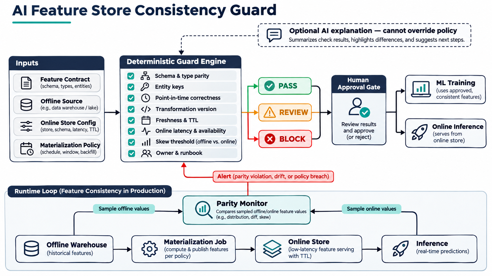

# AI Feature Store Consistency Guard

A deterministic promotion gate for preventing training-serving skew, stale online features, unsafe backfills, and unowned feature-store failures before an ML feature view reaches production.



## Why this problem matters now

Production ML platforms typically serve historical features to training jobs and low-latency features to online inference. The same logical feature can diverge across those paths because of schema changes, transformation revisions, late materialization, TTL errors, or point-in-time leakage. The result may be a model that tested well offline but receives materially different values in production.

The topic was selected after validating two signals on 2026-11-09:

- Official platform guidance: AWS documents online stores for low-latency inference, offline stores for historical training data, synchronization to avoid training-serving discrepancies, and explicit online TTL behavior. Google Cloud documents that a feature view must be synchronized before online serving and resolves current values using entity IDs and feature timestamps.
- Current hiring demand: live ML-platform postings from Hadrian, BetterHelp, Chime, FutureFit AI, and Whatnot require combinations of feature stores or online/offline feature integrity, Kubernetes, observability, CI/CD, production inference, and platform ownership.

Detailed sources and the screening record are in [docs/research.md](docs/research.md).

## What the guard checks

The policy evaluates 16 controls: feature identity, offline/online schema parity, transformation provenance, point-in-time retrieval, freshness, TTL, serving latency and availability, mismatch and sample size, materialization cadence, idempotent backfills, encryption, RBAC, ownership, operations, and human approval.

Blocking failures return `BLOCK`; operational SLO or evidence gaps return `REVIEW`; only a fully compliant contract returns `PASS`. AI can summarize findings, but it cannot change policy results or approve a promotion.

## Quick start

```bash
python -m venv .venv
. .venv/bin/activate
pip install -e '.[test]'
pytest -q
feature-consistency-guard samples/compliant-contract.yaml
feature-consistency-guard samples/skewed-contract.yaml --json
```

The compliant contract exits `0`. A `REVIEW` or `BLOCK` result exits `2`, which makes the tool suitable for CI and GitOps promotion gates.

## Architecture and workflow

1. A team submits a contract with offline, online, transformation, materialization, security, parity, and ownership evidence.
2. The deterministic guard evaluates the same controls locally and in CI.
3. `PASS`, `REVIEW`, or `BLOCK` is emitted with rule-level evidence.
4. A human reviews the evidence. A passing result is necessary but never sufficient for production promotion.
5. At runtime, sampled online and offline values feed the same mismatch policy so drift can reopen the gate.

The implementation is provider-neutral. A production adapter can translate Feast, SageMaker Feature Store, Vertex AI Feature Store, Redis, BigQuery, or warehouse metadata into the contract without changing the policy core.

## Measurable evaluation criteria

- 100% of feature views produce a machine-readable decision before release.
- Promotion blocks when sampled mismatch exceeds the declared threshold.
- Observed age stays at or below the feature freshness SLO.
- p95 latency and availability meet declared targets.
- Known-bad fixtures exercise every blocking path and CI stays green.
- Teams track escaped skew incidents, mean time to identify bad materialization, review time, and false-positive rate.

These are evaluation criteria, not invented production claims. Establish a baseline before reporting improvement.

## Safe deployment

Start in report-only mode against a non-production metadata export. Tune thresholds per feature class, validate sample quality, then shadow the production promotion path. Only after false positives are understood should CI enforce blocking rules. Keep infrastructure and data-plane changes behind a separate reviewed GitOps pull request; this repository performs no cloud mutation.

See [docs/deployment.md](docs/deployment.md) for rollout, rollback, failure modes, security controls, and Kubernetes/GitOps guidance.

## Security, privacy, and reliability

- Contracts contain metadata and aggregate measurements, never raw features or customer identifiers.
- Use short-lived workload identity and read-only metadata access.
- Redact endpoints and credentials; sign and retain decision evidence.
- Treat AI explanations as untrusted text; deterministic policy and human approval remain authoritative.
- Exact schema equality is conservative; intentional migrations need a versioned dual-read plan.
- Sampling may miss rare skew, so use stratification and production canaries as complementary controls.

## Interview positioning

Use this project to discuss an ML-platform incident where the model artifact is valid but training and inference see different features. Explain the separation of evidence, deterministic decision, and human authority; how point-in-time joins prevent leakage; why TTL and materialization cadence are related; and how report-only rollout protects developer velocity. The project demonstrates Python, tests, CI/CD, SRE controls, security boundaries, ML-platform operations, and evidence-based trade-offs.

## Repository contents

- `src/feature_consistency_guard/` — evaluator and CLI
- `samples/` — compliant and known-bad contracts
- `tests/` — unit and policy tests
- `policy/` — machine-readable decision model
- `docs/` — architecture, research, and deployment guidance
- `social/` — Medium, LinkedIn, and email-ready material
- `.github/workflows/ci.yml` — repeatable validation
