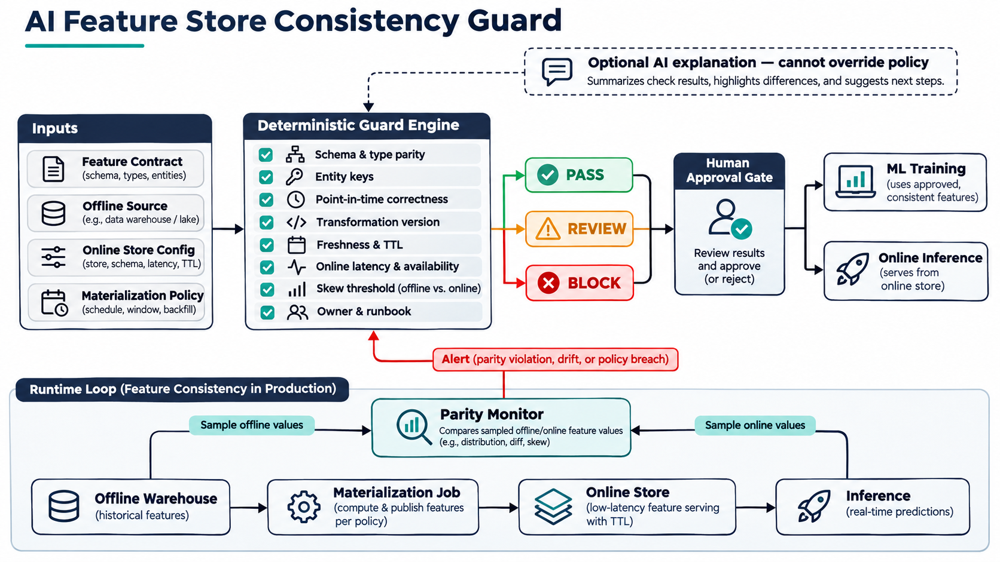

# Preventing Training-Serving Skew with a Deterministic Feature Store Consistency Gate

Training-serving skew is easy to underestimate. A model can be reproducible and healthy in offline evaluation while receiving a different feature contract at real-time inference. A schema migrated in only one store, a transformation deployed from another revision, late materialization, unsafe backfill, or TTL shorter than the freshness window can invalidate the model's assumptions.

This is a platform reliability problem, not merely a data-science problem.

## Why it matters now

Managed feature stores intentionally serve two workloads. Historical offline data supports training and batch inference; a low-latency online store supports real-time predictions. AWS documents both modes, synchronization to avoid discrepancies, and TTL behavior. Google Cloud documents synchronization before serving and uses entity IDs and timestamps to select current values.

Current ML-platform roles at Hadrian, BetterHelp, Chime, FutureFit AI, and Whatnot ask for feature-store ownership, training-serving integrity, Kubernetes, distributed systems, observability, CI/CD, incident response, and production inference. Hadrian explicitly calls for contract integrity between online and offline feature tables and proactive skew detection.

## The project

I built the AI Feature Store Consistency Guard as a deterministic promotion gate. A team supplies a versioned contract containing offline and online schemas, entity keys, transformation provenance, freshness, TTL, serving SLOs, sampled parity evidence, materialization behavior, security, and ownership.

The guard returns `PASS`, `REVIEW`, or `BLOCK`. A pass still requires human approval. Optional AI may summarize differences, but cannot change a rule, alter evidence, or override the gate.

## Implementation and workflow

The Python engine evaluates 16 controls: schema and type parity, entity keys, immutable transformations, point-in-time joins, freshness, TTL, online latency and availability, sampled mismatch, sample size, materialization cadence, idempotent backfills, encryption, RBAC, ownership, runbooks, alerts, and approval.

The provider-neutral contract is deliberate. Feast, SageMaker Feature Store, Vertex AI Feature Store, Redis, BigQuery, or an internal system can render the same evidence while policy semantics stay stable. The CLI exits non-zero for `REVIEW` and `BLOCK`, making it suitable for GitHub Actions or GitOps.

## Tests and validation

Tests start with a compliant view, then change one control at a time. They verify blocking for missing entity keys, schema mismatch, mutable transforms, disabled point-in-time joins, stale features, unsafe TTL, excessive mismatch, late materialization, unsafe backfills, incomplete encryption, weak access control, and missing approval. Separate tests prove that latency and runbook gaps require review.

The repository includes a known-bad contract, machine-readable policy, JSON validation, compilation, a non-root container, and GitHub Actions CI.

## Deployment, security, and reliability

Start in report-only mode against sandbox metadata, shadow one release cycle, tune thresholds by feature class, then enforce blocking rules. Give the evaluator read-only metadata access and no permission to mutate a feature store, Kubernetes resource, or cloud environment. Use workload identity, pin the image digest, sign decision artifacts, and separate evidence collection from approval.

If metadata is unavailable, fail closed for new promotions while leaving current inference traffic untouched. For intentional schema migration, publish a new version and dual-read it rather than weakening parity.

Contracts carry metadata and aggregate measurements—not raw features or customer identifiers. Sampling remains a trade-off: stratification, canaries, source-quality tests, and model monitoring complement the gate.

## Measurable outcomes and trade-offs

The project defines evaluation criteria instead of inventing results: 100% promotion coverage, zero releases above the mismatch threshold, freshness within SLO, serving latency and availability within target, and green tests for every known-bad path. Teams can compare escaped skew incidents, stale-feature rate, detection time, review duration, and false-positive rate before and after rollout.

The key design decision was separating evidence, decision, and authority. Telemetry supplies evidence. Deterministic policy produces a decision. A named human retains authority. AI improves legibility without collapsing those boundaries.

This is interview evidence for Cloud, DevOps, SRE, Platform Engineering, MLOps, and AI-infrastructure roles because it connects ML correctness to versioned contracts, CI/CD, observability, failure isolation, security, ownership, rollback, and SLOs.

Repository: https://github.com/ohjeffkuston/ai-feature-store-consistency-guard
